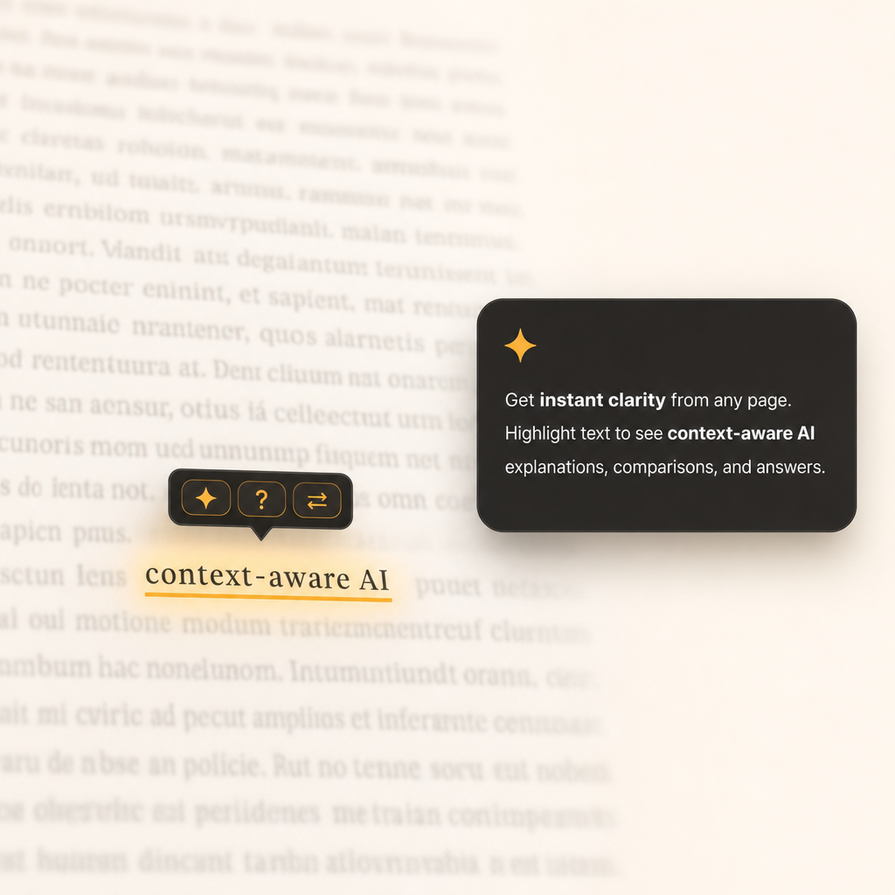
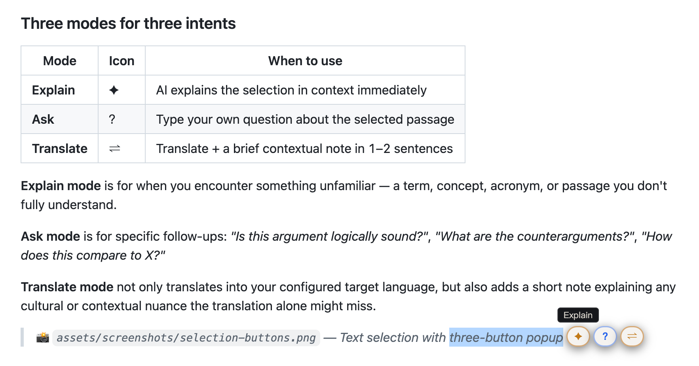
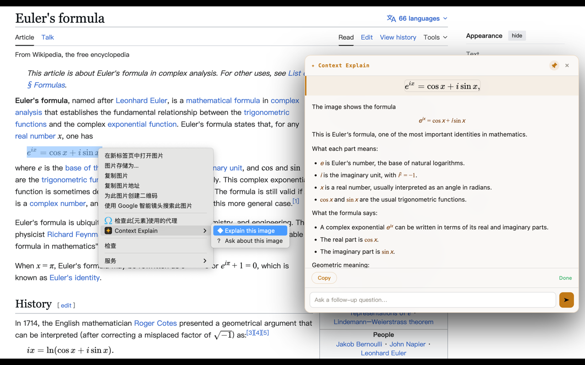
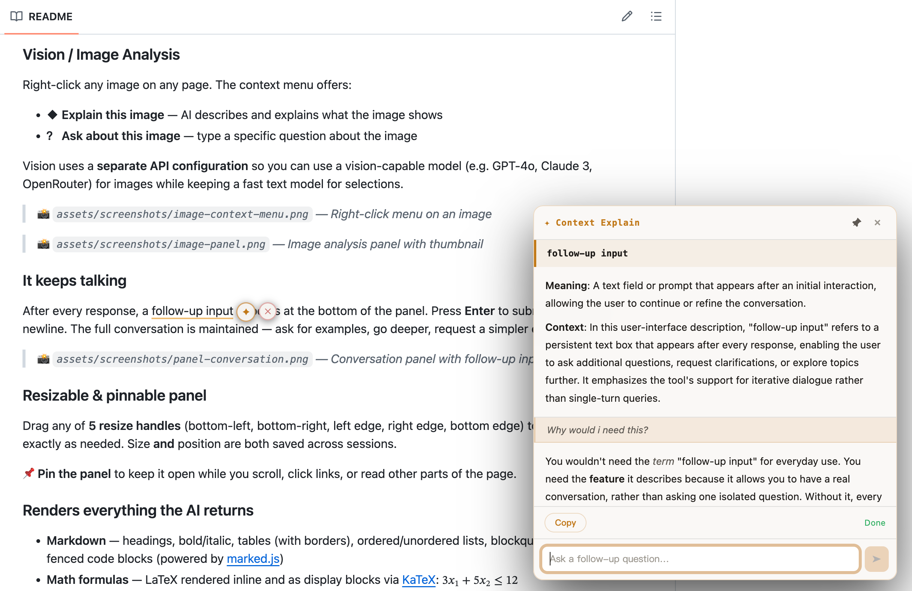
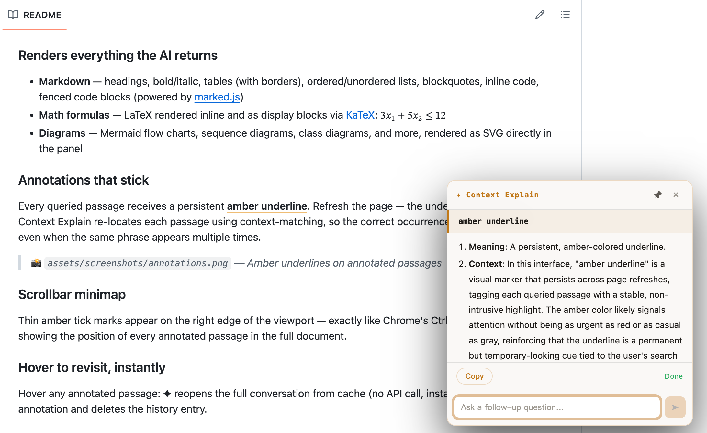
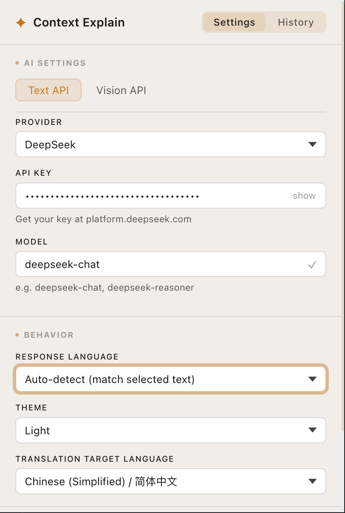
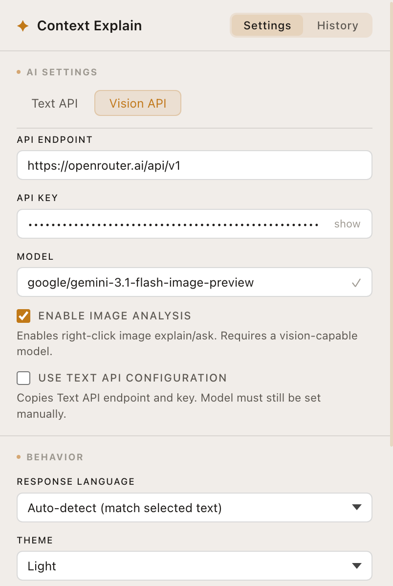
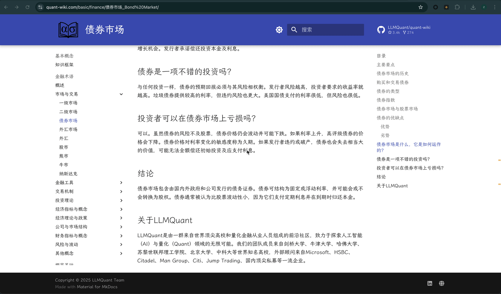

<div align="center">


# ✦ Context Explain

**AI-powered contextual explanations, right where you read.**

[](https://github.com/luzion89/Context-Explain/releases/latest)
[](LICENSE)
[](https://github.com/luzion89/Context-Explain/releases)
[](https://developer.chrome.com/docs/extensions/mv3/)

English · [中文](README_ZH.md) · [Download](https://github.com/luzion89/Context-Explain/releases/latest)

---



</div>

---

**Sign In with ChatGPT (local preview).** In Settings → Text API, select OpenAI (Sign In with ChatGPT), authorize ChatGPT plan access, optionally choose a model from the account’s model list, and save. Independent Vision API settings are required for image requests. The extension requires Chrome 121 or later.

## v2.3.3 preview

- Keep the conversation panel within view when resizing it during a streamed reply. Scroll up to pause automatic following, then return to the bottom to resume. Drag the top edge to change the height.
- Connect a ChatGPT account for text requests. This integration has been tested with a simulated account. Live authorization in Context Explain is pending.

## v2.3.2 updates

- DeepSeek Thinking and Network preferences persist across conversations and browser restarts.
- The settings footer links to GitHub Issues for support with a localized label.

## v2.3.1 updates

- Fixed BookOrbit page turns caused by clicks on extension controls.
- The popup footer now displays the installed manifest version. Selection compatibility is documented below.

## v2.3.0 reader compatibility

- Text actions work in frames where Chrome permits injection, including eligible nested and dynamic frames.
- Native selections in Foliate EPUB chapters, HTML PDF text layers, and open shadow roots use their own document or root. Context comes from the selected range and is limited to 500 characters on each side.
- Reader conversations keep the reading page as their source. Page annotations still work on supported web documents with stable addresses. EPUB, PDF text layers, temporary frames, and shadow roots skip source-text markup. EPUB history does not store CFI.
- The built-in Chrome PDF viewer, pages that block extension injection, closed shadow roots, and scanned or canvas-only pages do not expose usable DOM selections. The tested WeRead chapter rendered its body in a canvas without a native text selection. Use a selectable HTML text layer for PDF documents where available.

See the [compatibility notes and test instructions](docs/reader-compatibility.md).

## Updates in v2.2.0–v2.2.3

- **Model discovery** for text and vision settings: OpenAI, Anthropic (including pagination), DeepSeek, and third-party OpenAI-compatible `/models` endpoints. Search the returned IDs or enter a custom ID; manual entry remains available after failures.
- **DeepSeek Thinking and Network** switches for the next text request. Network currently requires `deepseek-flash`; the model decides when to search and additional charges may apply. Explain/Translate send their initial request immediately; use switches for follow-ups, or set them before the first request in Ask mode.
- **Settings and panel improvements**: discovery button beside the model label, examples inside inputs, no divider above Save, and a follow-up composer visible during streaming (send after completion).
- **Localization** in English, Simplified Chinese, Japanese and Korean for discovery notices, connection feedback, panel buttons and status text. Successful discovery notices update on language changes; Recap uses the interface language.
- **Prompt management** tab: edit eight templates for explanation, questions, translation, recap, image explanation and system instructions. Overrides are stored locally per language with reset-to-default and template variables. Save before switching languages; changes apply to new requests.

Limitations: discovered IDs are not guaranteed to support the selected chat/vision API. Search metadata is retained in the open conversation, not fully restored from history. Syntax, mocked requests, prompt and history checks pass; real Chrome/API validation is still required.

## ✦ What is Context Explain?

Highlight **a word, phrase, or passage** on a supported webpage. Three small buttons appear. Click to get an instant AI explanation that understands exactly where you are — the sentences before and after, the topic of the page, the register of the text.

Right-click any **image** to ask the AI what it shows, or pose a specific question about it.

No copy-paste. No new tabs. No context lost.

---

## 🆕 What's new in v2.0.0

| # | Feature | Summary |
|---|---|---|
| 1 | 🖼️ **Vision / Image Analysis** | Right-click any image → explain or ask about it using a separate Vision API |
| 2 | ⇌ **Translate mode** | Third button on text selection — translates + explains context in 1–2 sentences |
| 3 | ↔️ **Resizable panel** | Drag any of 5 edges/corners to resize; size and position remembered across sessions |
| 4 | 📌 **Pin panel** | Keep the panel open while clicking elsewhere on the page |
| 5 | ↻ **Retry button** | Re-run the last query if the stream fails or gives an unsatisfying answer |
| 6 | 🔍 **Full-text history search** | Search across term + explanation + all follow-up Q&A; image entries show thumbnail |
| 7 | ⚙️ **Unified AI Settings** | Text API and Vision API in tabbed sub-panels; inline ✓ test-connection button |
| 8 | 🌐 **UI localization** | Settings interface language follows your Response Language setting |
| 9 | 📊 **Markdown table borders** | Properly rendered table borders in panel and history detail view |
| 10 | 🎨 **Theme & polish** | Separate Translation Target Language; dark-mode WCAG contrast; Enter submits follow-up |

---

## 🎯 Why it's different

### Context-aware, not dictionary-aware

Most lookup tools treat every word in isolation. Context Explain captures the surrounding passage and sends it to the AI alongside your selection. "Transformer" on a machine learning paper gets an architecture explanation. "Transformer" on an electrical engineering page gets something entirely different.

### Three modes for three intents

| Mode | Icon | When to use |
|---|---|---|
| **Explain** | ✦ | AI explains the selection in context immediately |
| **Ask** | ？ | Type your own question about the selected passage |
| **Translate** | ⇌ | Translate + a brief contextual note in 1–2 sentences |

**Explain mode** is for when you encounter something unfamiliar — a term, concept, acronym, or passage you don't fully understand.

**Ask mode** is for specific follow-ups: *"Is this argument logically sound?"*, *"What are the counterarguments?"*, *"How does this compare to X?"*

**Translate mode** not only translates into your configured target language, but also adds a short note explaining any cultural or contextual nuance the translation alone might miss.

<figure><figcaption><em>Select any text — three buttons appear instantly</em></figcaption></figure>

### Vision / Image Analysis

Right-click any image on any page. The context menu offers:
- **◆ Explain this image** — AI describes and explains what the image shows
- **？ Ask about this image** — type a specific question about the image

Vision uses a **separate API configuration** so you can use a vision-capable model (e.g. GPT-4o, Claude 3, OpenRouter) for images while keeping a fast text model for selections.

<figure><figcaption><em>Right-click any image to explain or ask about it</em></figcaption></figure>

### It keeps talking

After every response, a follow-up input appears at the bottom of the panel. Press **Enter** to submit, **Ctrl+Enter** for a newline. The full conversation is maintained — ask for examples, go deeper, request a simpler explanation.

<figure><figcaption><em>Full conversation panel with unlimited follow-up questions</em></figcaption></figure>

### Resizable & pinnable panel

Drag any of **5 resize handles** (bottom-left, bottom-right, left edge, right edge, bottom edge) to resize the panel exactly as needed. Size **and** position are both saved across sessions.

**📌 Pin the panel** to keep it open while you scroll, click links, or read other parts of the page.

### Renders everything the AI returns

- **Markdown** — headings, bold/italic, tables (with borders), ordered/unordered lists, blockquotes, inline code, fenced code blocks (powered by [marked.js](https://marked.github.io/marked/))
- **Math formulas** — LaTeX rendered inline and as display blocks via [KaTeX](https://katex.org/): $3x_1 + 5x_2 \leq 12$
- **Diagrams** — Mermaid flow charts, sequence diagrams, class diagrams, and more, rendered as SVG directly in the panel

### Annotations that stick

Every queried passage receives a persistent **amber underline**. Refresh the page — the underlines come back. Context Explain re-locates each passage using context-matching, so the correct occurrence is always highlighted even when the same phrase appears multiple times.

<figure><figcaption><em>Persistent amber underlines restored after page reload</em></figcaption></figure>

### Scrollbar minimap

Thin amber tick marks appear on the right edge of the viewport — exactly like Chrome's Ctrl+F highlights — showing the position of every annotated passage in the full document.

### Hover to revisit, instantly

Hover any annotated passage: **✦** reopens the full conversation from cache (no API call, instant), **✕** removes the annotation and deletes the history entry.

### Works everywhere, including with Immersive Translate

Context Explain coexists with [Immersive Translate](https://immersivetranslate.com/) and other page-modifying extensions. Selection detection uses both `mouseup` and `selectionchange` events, with synchronous Range capture before any DOM mutation can invalidate it.

### API calls in the content script — no dropped streams

v2 uses a minimal service worker solely for registering the right-click context menu (a Chrome MV3 requirement). All AI API calls are made directly from the content script — which lives as long as the tab — so streams never drop mid-response due to the 30-second service worker idle timeout.

---

## ✨ Feature overview

| | |
|---|---|
| 🤖 **AI Providers** | OpenAI · Anthropic Claude · DeepSeek · any OpenAI-compatible API |
| 🖼️ **Vision** | Image explanation & Q&A via separate Vision API config |
| ⇌ **Translate mode** | Translate + brief context note; configurable target language |
| 💬 **Multi-turn** | Full conversation history, unlimited follow-ups |
| 📐 **Math rendering** | KaTeX — inline and display LaTeX |
| 🔀 **Diagrams** | Mermaid — flow charts, sequence diagrams, class diagrams, Gantt, and more |
| 📝 **Markdown** | Full GFM via marked.js — tables with borders, task lists, code blocks |
| 🖊️ **Annotations** | Persistent amber underlines, restored after page reload |
| 🗺️ **Scrollbar markers** | Viewport minimap of all annotated positions |
| 🪟 **Panel** | Draggable, resizable (5 handles), pinnable — position & size saved |
| 📌 **Pin** | Keep panel open while interacting with the page |
| ↻ **Retry** | Re-run last query on failure or dissatisfaction |
| 📚 **History** | Full-text search · Export Markdown ZIP · Delete individual entries · Image thumbnails |
| ⚡ **Streaming** | RAF-throttled render, Markdown on completion only |
| 💾 **Storage** | `chrome.storage.local` + `unlimitedStorage`, up to 2000 entries |
| 🌐 **UI localization** | Settings in EN / 简体中文 / 日本語 / 한국어 |
| 🔒 **Privacy** | All data stays local or goes to your own API — no third-party servers |

---

## 🚀 Installation

### Option 1 — Download the latest release (recommended)

1. Go to [**Releases**](https://github.com/luzion89/Context-Explain/releases/latest)
2. Download `context-explain-v*.zip`
3. Unzip it
4. Open Chrome → `chrome://extensions` → enable **Developer mode**
5. Click **Load unpacked** → select the unzipped folder
6. Click **✦** in your toolbar → enter your API key → **Save Settings**

### Option 2 — Clone and run

```bash
git clone https://github.com/luzion89/Context-Explain.git
```

Then load the folder via **Load unpacked** as above.

---

## ⚙️ Setup

Click the **✦** toolbar icon to open settings. Settings are split into two tabs:

### Text API tab

| Field | Notes |
|---|---|
| **Provider** | OpenAI / Anthropic / DeepSeek / Custom |
| **API Key** | Your key from the provider's dashboard |
| **Model** | Leave blank to use the default, or specify any model — click **✓** to test |
| **Base URL** | Only for custom OpenAI-compatible endpoints |

<figure><figcaption><em>Text API settings — configure your AI provider, model, and API key</em></figcaption></figure>

### Vision API tab

| Field | Notes |
|---|---|
| **Enable Image Analysis** | Toggle right-click image features on/off |
| **API Endpoint** | Any OpenAI-compatible vision endpoint (e.g. `https://api.openai.com/v1`) |
| **API Key** | Key for the vision endpoint |
| **Model** | e.g. `gpt-4o`, `claude-3-5-sonnet`, or any OpenRouter vision model — click **✓** to test |
| **Use Text API configuration** | Copy endpoint & key from the Text API tab |

<!-- Screenshot: Settings popup — Vision API tab -->
> 📸 *`assets/screenshots/settings-vision-api.png` — Vision API settings tab*

<figure><figcaption><em>Vision API settings — configure a separate vision-capable model for image analysis</em></figcaption></figure>

### Behavior

| Field | Notes |
|---|---|
| **Response Language** | Auto (matches selected text language) or force a specific language |
| **Theme** | Follow System / Light / Dark |
| **Translation Target Language** | Language used by the ⇌ Translate button |

### Recommended models

| Use case | Provider | Model |
|---|---|---|
| Fast everyday lookups | OpenAI | `gpt-4o-mini` |
| Richer explanations | Anthropic | `claude-3-5-sonnet-20241022` |
| Cost-effective | DeepSeek | `deepseek-chat` |
| Image analysis | OpenAI | `gpt-4o` |
| Image via OpenRouter | OpenRouter | `google/gemini-flash-1.5` |

---

## 📖 How to use



### Text selection

```
1. Select any text on any webpage
   ↓
2. Three buttons appear at the end of the selection
   ✦  →  Explain mode: AI explains immediately
   ？  →  Ask mode: type your own question
   ⇌  →  Translate mode: translation + brief context note
   ↓
3. Response streams in the floating panel
   Math, diagrams, and tables render automatically
   ↓
4. Follow-up input appears when done — Enter to submit, Ctrl+Enter for newline
   ↓
5. Close the panel — amber underline stays on the text
   ↓
6. Hover the underline anytime to reopen the full conversation instantly
```

### Image analysis

```
1. Right-click any image on any webpage
   ↓
2. Choose from the context menu:
   ◆ Explain this image  →  AI describes and explains the image
   ？ Ask about this image  →  type a specific question about it
   ↓
3. Response streams in the panel — same follow-up flow as text mode
```

### Panel controls

| Action | Function |
|---|---|
| Drag header | Move the panel |
| Drag edge/corner handles | Resize the panel (5 handles: SW, SE, left, right, bottom) |
| **📌 Pin button** | Keep panel open while interacting with the page |
| **↻ Retry button** | Re-run the last query |
| **✕ Close** | Close the panel (annotations remain) |

---

## 🔒 Privacy

- Selected text, context, and images are sent **only** to the API provider you configure
- This extension does **not** communicate with any server other than your chosen AI provider
- All history is stored **locally** in your browser via `chrome.storage.local`
- No analytics · No telemetry · No accounts · No data collection

---

## 🙏 Inspired by

[Select2Explain](https://github.com/luzion89/Select2Explain) — the original concept of bringing context-aware AI explanations directly onto the reading surface.

---

<div align="center">

**If this is useful to you, please consider giving it a ⭐**

</div>
